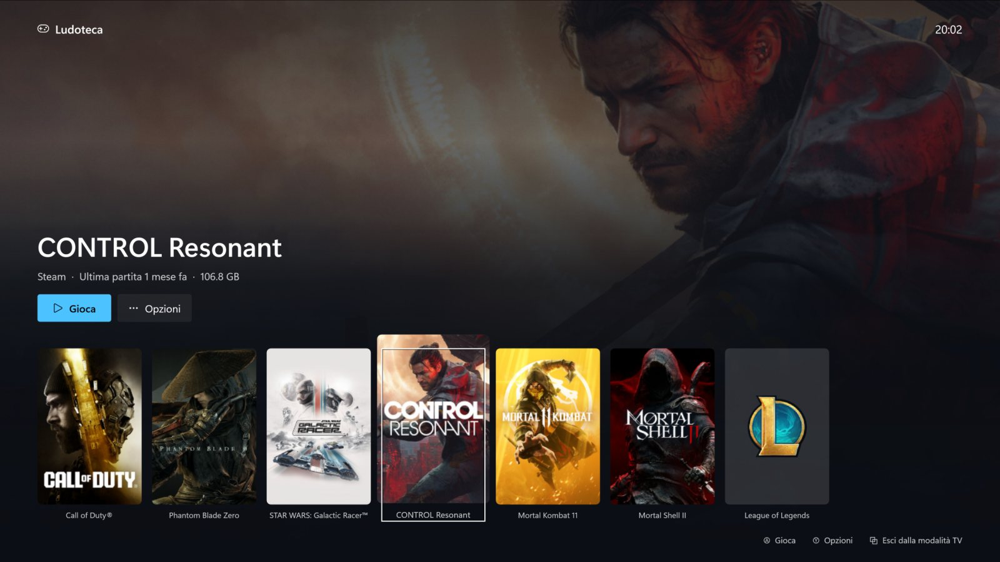

# Ludoteca

Un'app per Windows 11 che trova tutti i giochi installati sul PC, li avvia da un unico posto (anche dal divano, con il controller), li divide per disco e ti dice quali conviene disinstallare: quelli grandi a cui non giochi da più tempo.


## Cosa fa

- **Trova i giochi di tutti i launcher**: Steam, Xbox / Game Pass, Epic, Ubisoft Connect, Battle.net, Riot, GOG ed EA, più i giochi installati senza launcher che compaiono in "App installate".
- **Gioca da Ludoteca**: ogni gioco parte dal suo launcher (Steam, Xbox, Epic, Ubisoft, Riot, Battle.net), così login, overlay e aggiornamenti funzionano come sempre.
- **Modalità TV**: schermo intero con le copertine e lo sfondo del gioco, da usare con il controller o con la tastiera.
- **Ti consiglia cosa disinstallare**: in cima c'è una griglia con i giochi fermi da almeno un mese, ordinati per tempo dall'ultima partita e spazio occupato. È 3×3 se la finestra è larga e 2×2 se è stretta.
- **Ultima partita** per ogni gioco: esatta per Steam (con le ore giocate) e Battle.net, stimata dai salvataggi o dai log per Xbox, Ubisoft e Riot.
- **Vista per disco**, con lo spazio occupato dai giochi e quello libero su ogni disco.
- **Disinstallazione con un clic**: avvia il disinstallatore del launcher giusto (Steam, Ubisoft, Riot, Battle.net) oppure rimuove direttamente il pacchetto Xbox.
- **Copertine senza configurare niente**: dalla cache di Steam, dal negozio Steam e dal Microsoft Store. Se un gioco non c'è si usa la sua icona. Con una chiave gratuita di [SteamGridDB](https://www.steamgriddb.com) se ne trovano ancora di più.

| Finestra stretta | Per disco |
|---|---|
|  |  |


## Modalità TV



Si apre con il pulsante **Modalità TV**, con **F11**, con **Start** sul controller oppure avviando `Ludoteca.exe --tv`. I giochi giocati più di recente vengono per primi.

| Controller (Xbox o compatibile) | Tastiera | Azione |
|---|---|---|
| D-pad / stick sinistro | frecce | scorri i giochi, ↑ per i pulsanti |
| **A** | Invio | gioca |
| **Y** | tasto Menu | opzioni (gioca, disinstalla) |
| **B** | Esc | indietro, chiude i menu |
| **LB / RB** | | salta di 5 giochi |
| **View** (⧉) | Esc / F11 | esci dalla modalità TV |

Mentre giochi Ludoteca è in secondo piano e ignora il controller. Con uno Steam Controller, aggiungi Ludoteca a Steam come "gioco non Steam": così Steam Input lo presenta come un controller Xbox.

## Installazione

Scarica `Ludoteca-win-Setup.exe` dall'ultima [release](https://github.com/rawnly/ludoteca/releases/latest) e avvialo. In alternativa c'è `Ludoteca-win-Portable.zip`, che si usa senza installare.

- Serve **Windows 10 (versione 2004 o successiva) o Windows 11, a 64 bit**. Non serve installare .NET: è già incluso.
- Si installa solo per il tuo utente, senza permessi di amministratore, e si disinstalla da *Impostazioni → App installate*.
- **Si aggiorna da sola**: a ogni avvio controlla se c'è una nuova versione e, quando c'è, basta premere *Aggiorna e riavvia*. Scarica solo le differenze.
- L'installer non ha una firma digitale, quindi Windows SmartScreen mostra "Windows ha protetto il PC": premi **Ulteriori informazioni → Esegui comunque**.

> Hai la 1.3.0? Era installata con un sistema diverso e non si aggiorna da sola: installa la nuova versione e poi disinstalla la vecchia da *App installate*. Impostazioni e copertine vengono mantenute.

## Come trova i giochi

| Launcher | Dove guarda | Ultima partita |
|---|---|---|
| Steam | `libraryfolders.vdf` e i manifest `appmanifest_*.acf` | esatta, da `localconfig.vdf` |
| Xbox / Game Pass | il file `.GamingRoot` di ogni disco e i pacchetti installati (le DLC vengono saltate) | stimata dai salvataggi |
| Epic | i manifest in `ProgramData\Epic\EpicGamesLauncher` | — |
| Ubisoft, Riot, Battle.net, GOG | le voci di "App installate" | Battle.net esatta, gli altri stimata da salvataggi o log |
| Altri | le voci di "App installate" la cui cartella contiene file tipici dei giochi (Unity, Unreal, Steam API, Bink, DLSS…) | stimata dai salvataggi |

I giochi copiati a mano in una cartella, senza launcher né installatore, non vengono trovati.

La chiave di SteamGridDB viene salvata cifrata con il tuo account Windows (DPAPI). Impostazioni e copertine restano sul PC.

## Esportare l'elenco

```bash
Ludoteca.exe --export giochi.csv
```

Scrive un CSV (separato da `;`) con nome, launcher, disco, dimensione, ultima partita e cartella di ogni gioco, ed esce senza aprire la finestra.

## Compilare dal codice

Serve il [.NET 8 SDK](https://dotnet.microsoft.com/download/dotnet/8.0). Visual Studio non è necessario.

```bash
dotnet run
```

### Pubblicare una nuova versione

Installer e aggiornamenti sono gestiti da [Velopack](https://velopack.io). Servono la sua CLI (`dotnet tool install -g vpk`) e [GitHub CLI](https://cli.github.com) autenticata.

1. Alza `<Version>` in `Ludoteca.csproj` e fai commit e push.
2. Prepara e pubblica:

```bash
.\release.ps1 -Publish
```

Lo script compila l'app, crea in `releases\` il Setup, lo zip portatile e i pacchetti di aggiornamento (anche quello che contiene solo le differenze rispetto alla versione precedente) e li carica in una GitHub Release con tag `v<versione>`. Senza `-Publish` prepara tutto senza pubblicare niente.
