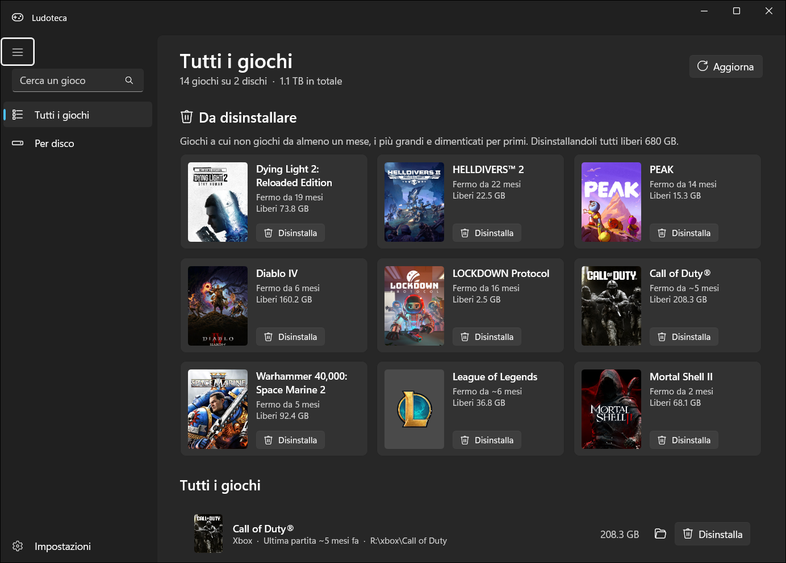
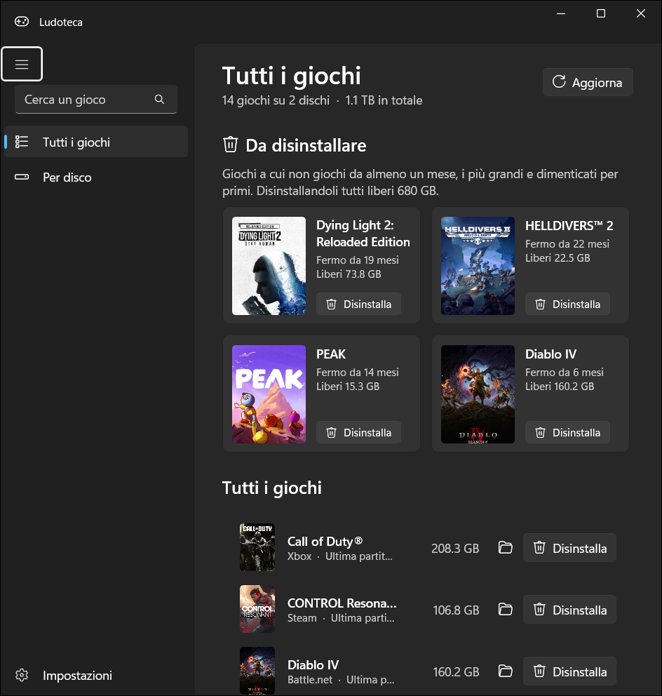
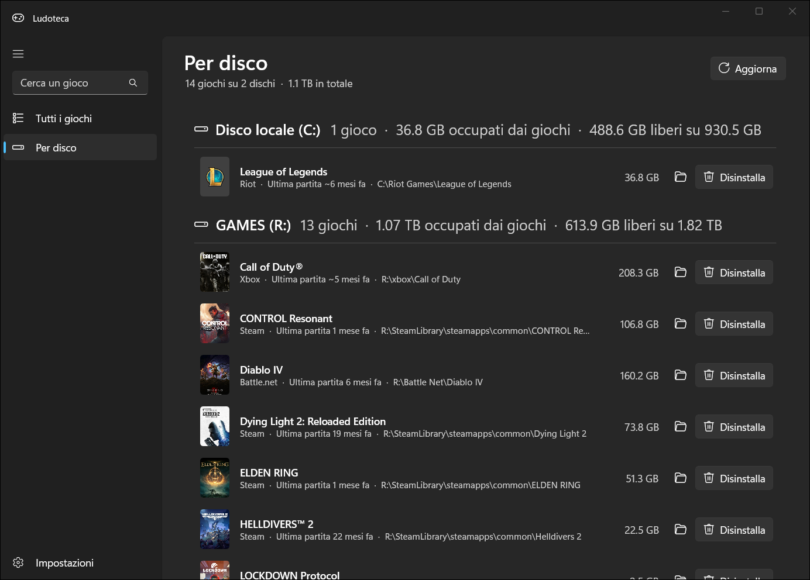
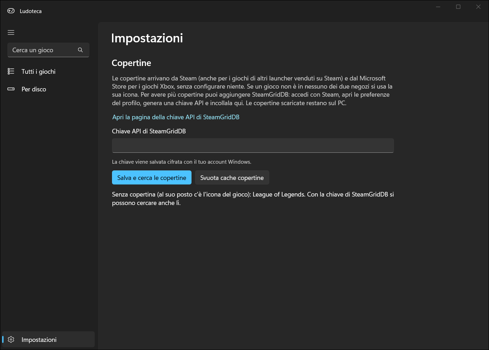

# Ludoteca

Un'app per Windows 11 che trova tutti i giochi installati sul PC, li divide per disco e ti dice quali conviene disinstallare: quelli grandi a cui non giochi da più tempo.



## Cosa fa

- **Trova i giochi di tutti i launcher**: Steam, Xbox / Game Pass, Epic, Ubisoft Connect, Battle.net, Riot, GOG ed EA, più i giochi installati senza launcher che compaiono in "App installate".
- **Ti consiglia cosa disinstallare**: in cima c'è una griglia con i giochi fermi da almeno un mese, ordinati per tempo dall'ultima partita e spazio occupato. È 3×3 se la finestra è larga e 2×2 se è stretta.
- **Ultima partita** per ogni gioco: esatta per Steam (con le ore giocate) e Battle.net, stimata dai salvataggi o dai log per Xbox, Ubisoft e Riot.
- **Vista per disco**, con lo spazio occupato dai giochi e quello libero su ogni disco.
- **Disinstallazione con un clic**: avvia il disinstallatore del launcher giusto (Steam, Ubisoft, Riot, Battle.net) oppure rimuove direttamente il pacchetto Xbox.
- **Copertine senza configurare niente**: dalla cache di Steam, dal negozio Steam e dal Microsoft Store. Se un gioco non c'è si usa la sua icona. Con una chiave gratuita di [SteamGridDB](https://www.steamgriddb.com) se ne trovano ancora di più.

| Finestra stretta | Per disco |
|---|---|
|  |  |



## Installazione

Scarica `Ludoteca-Setup-<versione>.exe` dall'ultima [release](https://github.com/rawnly/ludoteca/releases/latest) e avvialo.

- Serve **Windows 10 (versione 2004 o successiva) o Windows 11, a 64 bit**. Non serve installare .NET: è già incluso.
- Si installa solo per il tuo utente, senza permessi di amministratore, e si disinstalla da *Impostazioni → App installate*.
- L'installer non ha una firma digitale, quindi Windows SmartScreen mostra "Windows ha protetto il PC": premi **Ulteriori informazioni → Esegui comunque**.

## Come trova i giochi

| Launcher | Dove guarda | Ultima partita |
|---|---|---|
| Steam | `libraryfolders.vdf` e i manifest `appmanifest_*.acf` | esatta, da `localconfig.vdf` |
| Xbox / Game Pass | il file `.GamingRoot` di ogni disco e i pacchetti installati (le DLC vengono saltate) | stimata dai salvataggi |
| Epic | i manifest in `ProgramData\Epic\EpicGamesLauncher` | — |
| Ubisoft, Riot, Battle.net, GOG | le voci di "App installate" | Battle.net esatta, gli altri stimata da salvataggi o log |
| Altri | le voci di "App installate" la cui cartella contiene file tipici dei giochi (Unity, Unreal, Steam API, Bink, DLSS…) | stimata dai salvataggi |

I giochi copiati a mano in una cartella, senza launcher né installatore, non vengono trovati.

La chiave di SteamGridDB viene salvata cifrata con il tuo account Windows (DPAPI). Impostazioni e copertine restano sul PC.

## Esportare l'elenco

```bash
Ludoteca.exe --export giochi.csv
```

Scrive un CSV (separato da `;`) con nome, launcher, disco, dimensione, ultima partita e cartella di ogni gioco, ed esce senza aprire la finestra.

## Compilare dal codice

Serve il [.NET 8 SDK](https://dotnet.microsoft.com/download/dotnet/8.0). Visual Studio non è necessario.

```bash
dotnet run
```

Per creare l'installer serve [Inno Setup 6](https://jrsoftware.org/isinfo.php) (`winget install JRSoftware.InnoSetup`):

```bash
powershell -ExecutionPolicy Bypass -File installer\build.ps1
```

L'installer viene creato in `dist\`.
